<div align="center">


&nbsp;&nbsp;&nbsp;&nbsp;&nbsp;&nbsp;&nbsp;&nbsp;
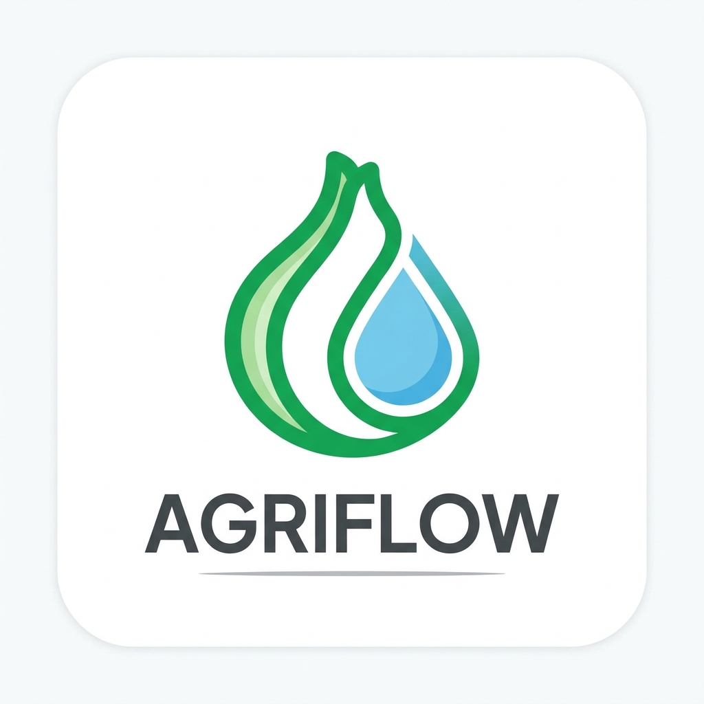

# AGRIFLOW (Allimation)
### Sistem Kontrol dan Monitoring Penyiraman Bawang Merah Berbasis IoT & Mobile Flutter

[](https://flutter.dev)
[](https://dart.dev)
[-660099?logo=mqtt&logoColor=white)](https://www.hivemq.com)
[](https://www.espressif.com)
[](#identitas-penelitian)

---

</div>

## 🎓 Identitas Penelitian

Aplikasi ini dikembangkan sebagai prototipe pengendali (*controller prototype*) dan pemantau telemetri irigasi lahan bawang merah guna memenuhi syarat kelulusan Sarjana Komputer (**S.Kom**):

| Entitas | Keterangan |
| :--- | :--- |
| **Nama Peneliti** | **EVA YUNIZAR SUGIARTO** |
| **NIM** | **STI202202907** |
| **Program Studi** | S1 Teknik Informatika |
| **Perguruan Tinggi** | **STMIK WIDYA UTAMA, PURWOKERTO** |
| **Tahun Pelaksanaan** | **2026** |
| **Judul Skripsi** | *“Rancang Bangun Sistem Kontrol dan Monitoring Penyiraman Bawang Merah Berbasis IoT Menggunakan Aplikasi Mobile Flutter (Studi Kasus: Kelompok Tani Dukuhwringin Brebes)”* |

---

## 📖 Deskripsi Proyek

Tanaman bawang merah (*Allium cepa L.*) memiliki sistem perakaran dangkal yang sangat rentan terhadap kekeringan maupun kejenuhan air tanah. Kelembapan tanah di bawah **60%** mengakibatkan umbi kerdil dan daun layu, sedangkan kelembapan di atas **80%** menyebabkan pembusukan umbi akibat aerasi tanah yang buruk (*over-irrigation*).

Aplikasi **AGRIFLOW (Allimation)** hadir sebagai antarmuka cerdas terpadu yang menghubungkan petani secara nirkabel dengan mikrokontroler **ESP32** di perkebunan melalui perantara broker aman **HiveMQ Cloud Serverless (Port 8883 TLS/SSL)**.

### Karakteristik & Logika Ambang Batas (Skripsi Thesis Logic):
- **Kondisi Kering (< 60%)**: Pompa menyala otomatis pada mode otomatis. Memicu pop-up darurat *"Kelembapan Tanah Kritis"* pada antarmuka pengguna disertai tombol aksi cepat *"💧 Siram Sekarang"*.
- **Kondisi Optimal (60% – 80%)**: Rentang ideal pertumbuhan bawang merah (*Terverifikasi*). Pompa siaga.
- **Kondisi Jenuh (> 80%)**: Pompa otomatis dimatikan paksa (*Over-Irrigation Protection*), tombol kendali manual dikunci sementara guna mencegah pembusukan umbi.

---

## 🌐 Arsitektur Komunikasi IoT (HiveMQ Cloud & ESP32)

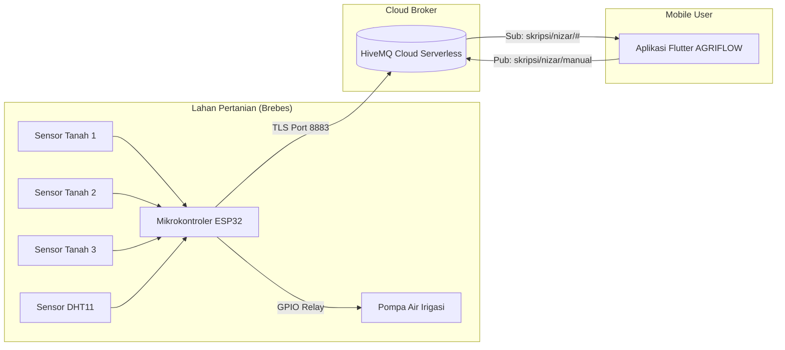

### Pemetaan Topik MQTT:
1. **`skripsi/nizar/status`** (Inbound): Menerima status koneksi LWT (*Last Will and Testament*) ESP32 (`ONLINE` atau `OFFLINE`) secara otomatis jika sinyal mikrokontroler putus mendadak.
2. **`skripsi/nizar/soil_detail`** (Inbound): Menerima payload JSON rincian 3 sensor kelembapan tanah di titik berbeda (`{"s1":2400,"s2":1800,"s3":1200,"avg":1800}`) untuk monitoring validasi media tanah.
3. **`skripsi/nizar/soil`** (Inbound): Menerima nilai ADC rata-rata 3 sensor kelembapan tanah kapasitif (0–4095) yang dikalibrasi secara matematis ke persentase 0–100%.
4. **`skripsi/nizar/temp`** (Inbound): Menerima suhu udara (°C) dari sensor DHT11.
5. **`skripsi/nizar/hum`** (Inbound): Menerima kelembapan relatif udara (%) dari sensor DHT11.
6. **`skripsi/nizar/pompa`** (Inbound): Menerima status relai riil hardware (`MENYIRAM (AUTO)`, `SIRAM MANUAL (5 DETIK)`, `JEDA RESAP`, `STANDBY`).
7. **`skripsi/nizar/manual`** (Outbound): Topik pengiriman perintah tombol dari aplikasi (`"SIRAM"` untuk aktivasi, `"0"` untuk mematikan).

---

## 📱 Tampilan Antarmuka Aplikasi (Mockup Visual & Hasil Pengujian)

<div align="center">

| 1. Beranda (Hardware Standby) | 2. Monitoring 3 Titik Sensor | 3. Respon Data (Simulasi Aktif) |
| :---: | :---: | :---: |
| 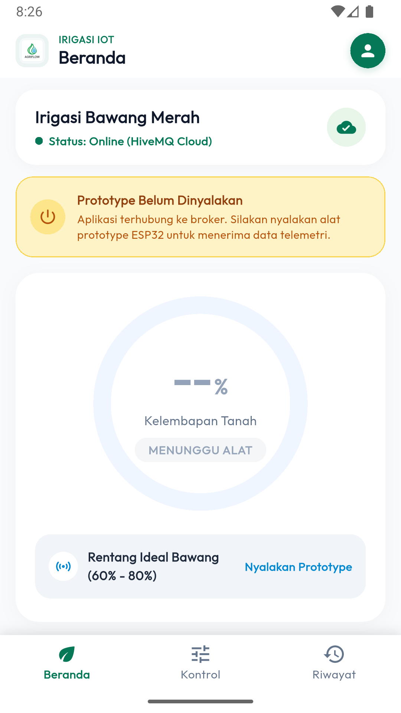 | 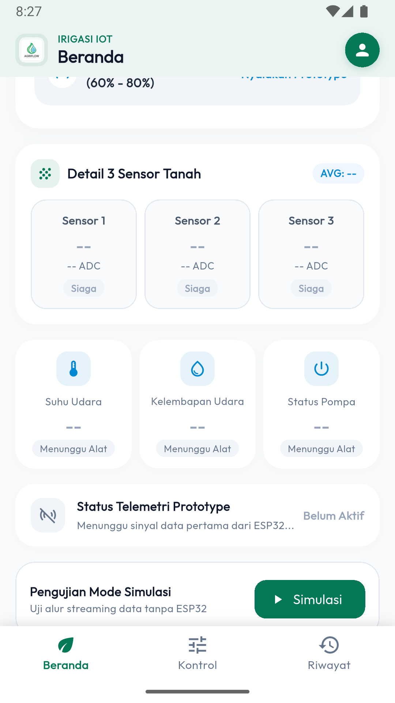 | 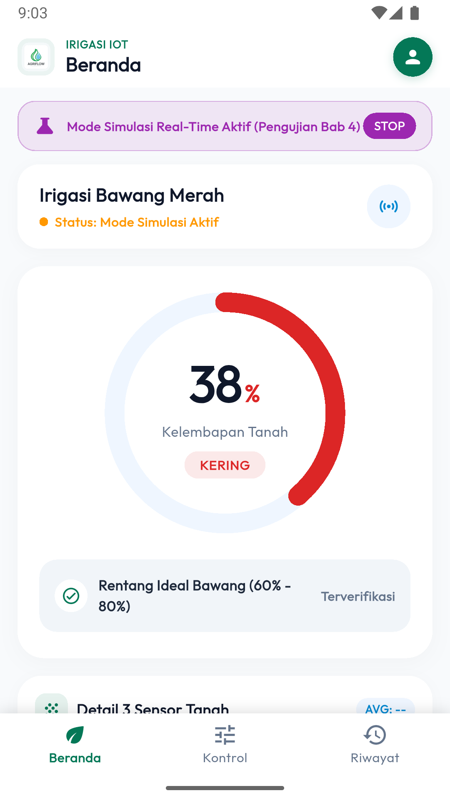 |
| *Deteksi prototype standby & status siaga tanpa data dummy* | *Rincian kelembapan 3 titik media tanah berbeda* | *Respon visual dashboard saat data telemetri masuk* |

| 4. Detail 3 Sensor (Nilai Riil) | 5. Kendali Pompa (Siaga) | 6. Pompa Aktif Menyiram |
| :---: | :---: | :---: |
| 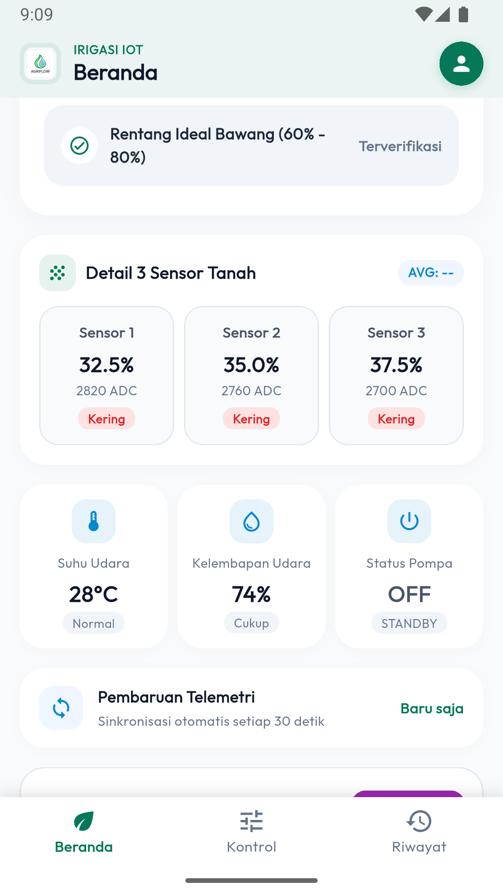 | 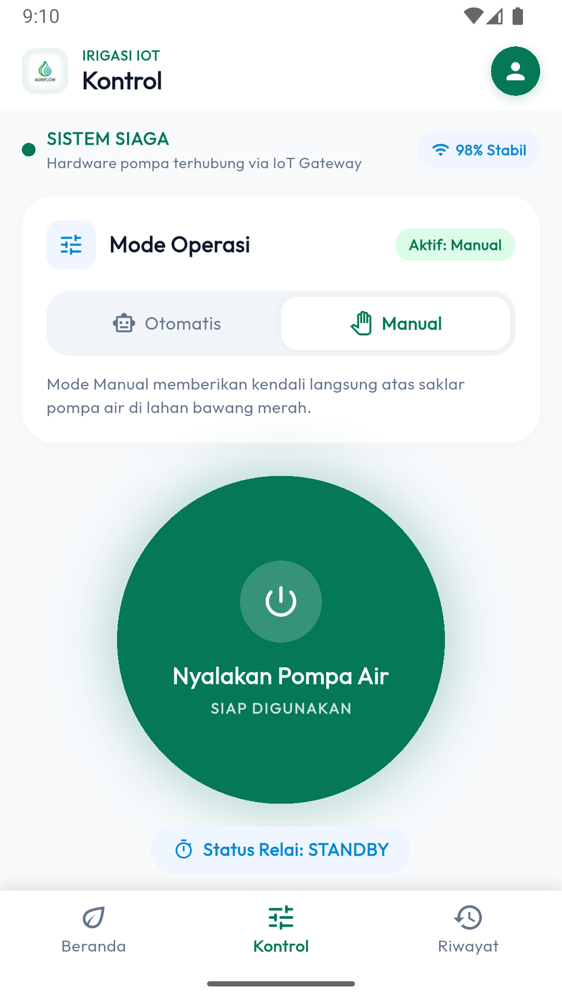 | 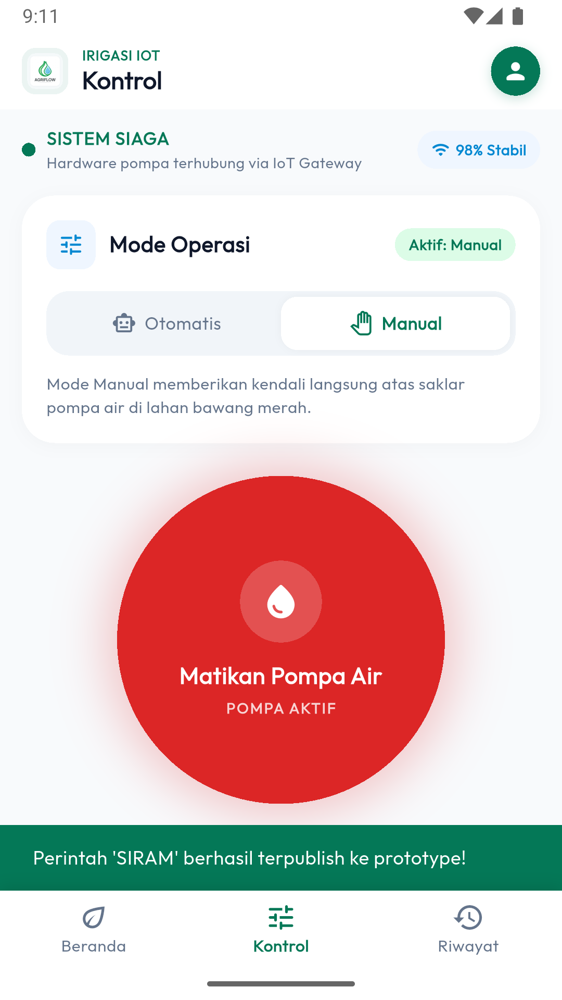 |
| *Validasi pembacaan ADC dan persentase tiap sensor* | *Saklar mode & tombol kendali melingkar hijau* | *Feedback visual 'SIRAM' terpublish ke prototype* |

| 7. Riwayat & Tren Telemetri | 8. Alert Kelembapan Kritis (< 60%) | 9. Dialog Gangguan Sinyal / LWT |
| :---: | :---: | :---: |
| 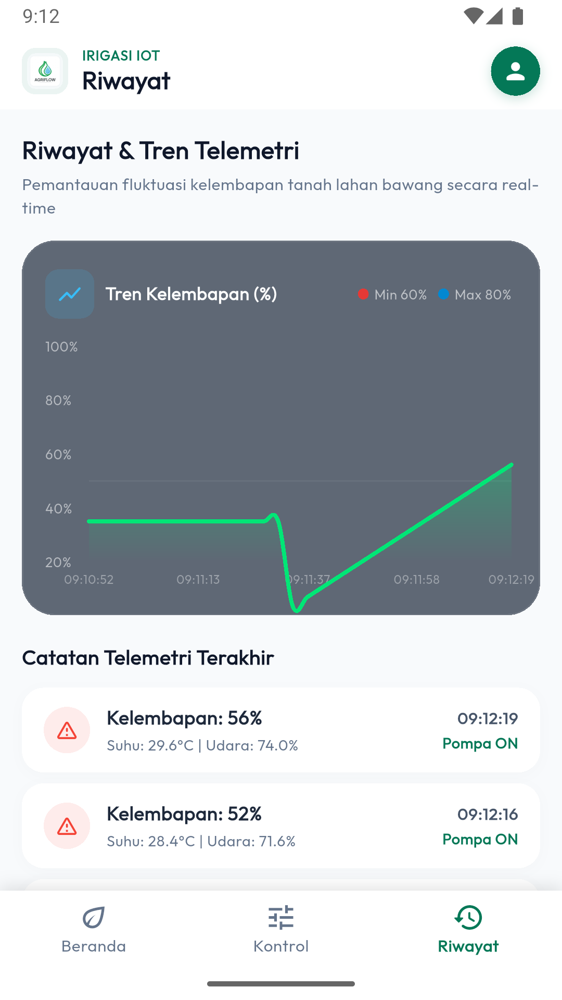 | 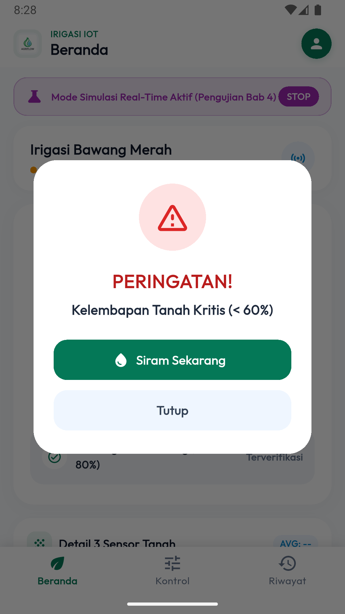 | 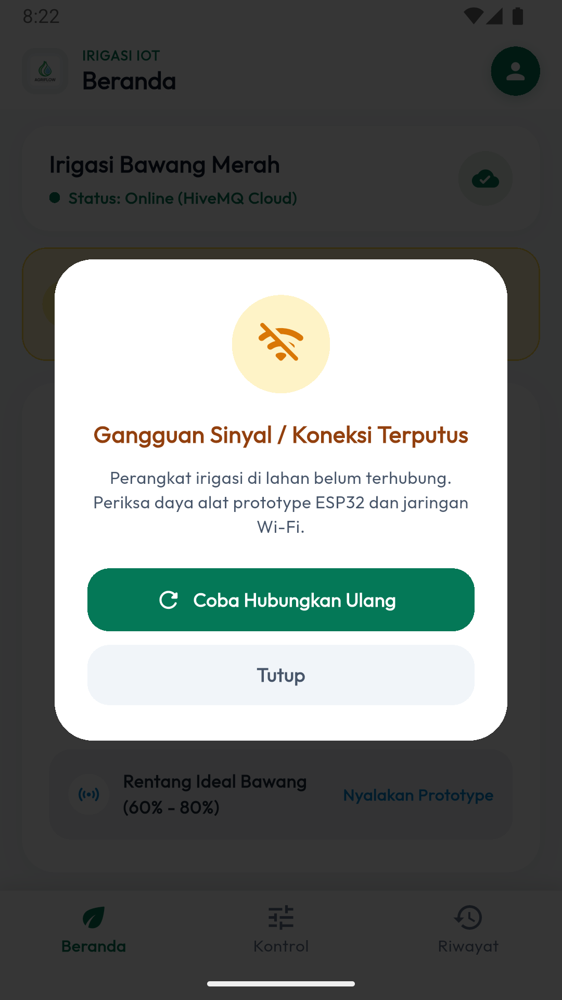 |
| *Grafik fluktuasi fl_chart real-time dengan batas ideal* | *Pop-up otomatis saat tanah kering (<60%) + tombol siram* | *Deteksi otomatis putus koneksi ESP32 (LWT / timeout)* |

| 10. Profil Akademik Pengembang |
| :---: |
| 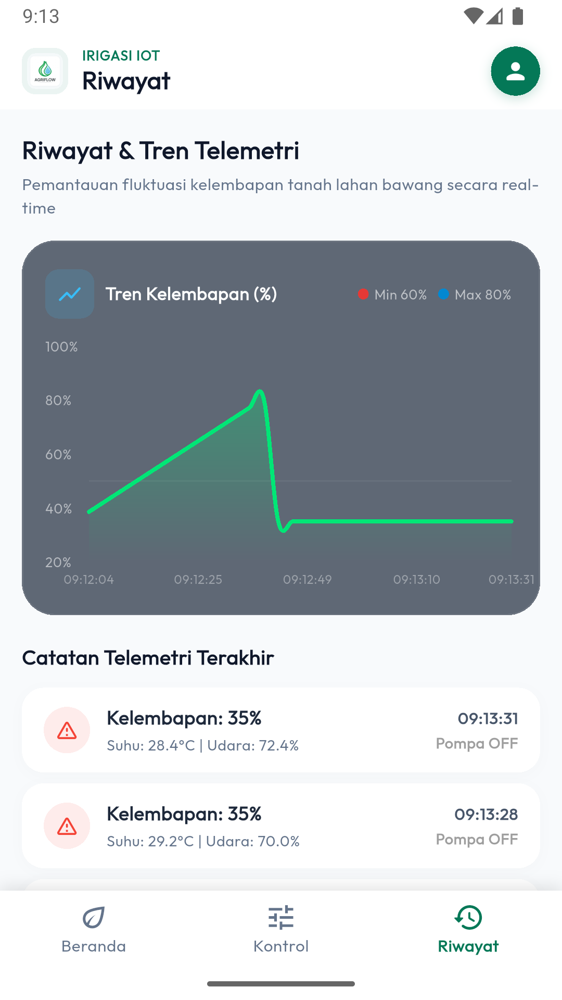 |
| *Identitas peneliti Skripsi & akses konfigurasi broker* |

</div>

---

## 💡 Fitur-Fitur Utama

1. **State Management Tanpa Data Dummy**:
   - Jika aplikasi dibuka saat prototype ESP32 belum dinyalakan, aplikasi **tidak memunculkan data dummy palsu**. Seluruh tampilan sensor tetap bersih (`--%`, `--°C`, `--`) dengan status **`MENUNGGU ALAT`** serta banner panduan menyalakan prototype.
   - Peringatan kritis dikunci agar tidak memicu alarm palsu sebelum data sensor fisik pertama diterima.
2. **Kendali Pompa Intuitif & Feedback Visual**:
   - Menggunakan *Big Circular Button* dengan status warna dinamis (Hijau Siaga / Merah Aktif).
   - Pesan feedback SnackBar yang ringkas dan profesional: *"Perintah 'SIRAM' berhasil terpublish ke prototype!"*.
3. **Grafik Tren Real-Time (`fl_chart`)**:
   - Kurva telemetri dilengkapi garis batas merah (Min 60%) dan biru (Max 80%).
4. **Mode Simulasi Real-Time**:
   - Tombol pengujian simulasi bawaan untuk mendemonstrasikan antarmuka dan kurva penurunan/kenaikan kelembapan tanpa memerlukan hardware fisik di tempat seminar.
5. **Konfigurasi Fleksibel**:
   - Dialog informasi pengembang akademik lengkap dengan shortcut menuju pengaturan broker MQTT (Host, Port, Username, Password, Topik, Slider Threshold, dan Tombol Uji Telemetri).

---

## 📂 Struktur Direktori Proyek

```text
allimation/
├── android/                 # Konfigurasi native Android & Gradle
├── assets/
│   └── images/              # Logo resmi AGRIFLOW & Logo STMIK Widya Utama
├── docs/
│   └── images/              # Dokumentasi tangkapan layar (Mockup)
├── ios/                     # Konfigurasi native iOS / Runner Xcode
├── lib/
│   ├── main.dart            # Entry point aplikasi & konfigurasi tema Light Agrotech
│   ├── models/
│   │   ├── mqtt_config.dart # Model konfigurasi koneksi broker HiveMQ
│   │   └── sensor_data.dart # Model telemetri data sensor & threshold logic
│   ├── providers/
│   │   └── irrigation_provider.dart # State management ChangeNotifier & SharedPreferences
│   ├── screens/
│   │   ├── dashboard_screen.dart    # Tab 0: Monitoring telemetri & status prototype
│   │   ├── kontrol_screen.dart      # Tab 1: Saklar mode & kendali pompa air
│   │   ├── main_navigation_screen.dart # Bottom Navigation bar & pemicu pop-up alert
│   │   ├── riwayat_screen.dart      # Tab 2: Grafik tren & catatan telemetri
│   │   └── settings_screen.dart     # Pengaturan dinamis broker MQTT & slider batas
│   ├── services/
│   │   └── mqtt_service.dart        # Socket client MQTT TLS 8883 & payload parser
│   └── widgets/
│       ├── developer_profile_dialog.dart # Modal profil akademik mahasiswa
│       ├── moisture_gauge.dart      # Circular percent indicator kelembapan tanah
│       ├── pop_up_alert.dart        # Dialog darurat kelembapan kritis < 60%
│       └── trend_chart.dart         # Komponen visual grafik fluktuasi fl_chart
├── test/                    # Unit testing logika model & parser MQTT
├── CHANGELOG.md             # Riwayat versi pembaruan aplikasi
├── walkthrough.md           # Dokumentasi teknis pengujian & sinkronisasi Skripsi
└── pubspec.yaml             # Manifest dependensi pustaka Flutter
```

---

## 🚀 Panduan Menjalankan Aplikasi

### Prasyarat:
- Flutter SDK `^3.10.0` atau yang lebih baru.
- Android Studio / VS Code dengan ekstensi Flutter & Dart.
- JDK 17 atau yang kompatibel dengan Gradle Android.

### 1. Unduh Dependensi
```bash
flutter pub get
```

### 2. Jalankan di Emulator atau Perangkat HP Android
```bash
flutter run
```

### 3. Build APK Versi Rilis (Release Bundle)
```bash
flutter build apk --release
```
Hasil paket file APK mandiri tersimpan pada:
```text
build/app/outputs/flutter-apk/app-release.apk
```

---

## 📄 Hak Cipta & Lisensi

Proyek ini dikembangkan oleh **Eva Yunizar Sugiarto** untuk kepentingan penelitian Skripsi pada **STMIK Widya Utama, Purwokerto**. Seluruh hak cipta karya ilmiah dilindungi undang-undang akademik.
